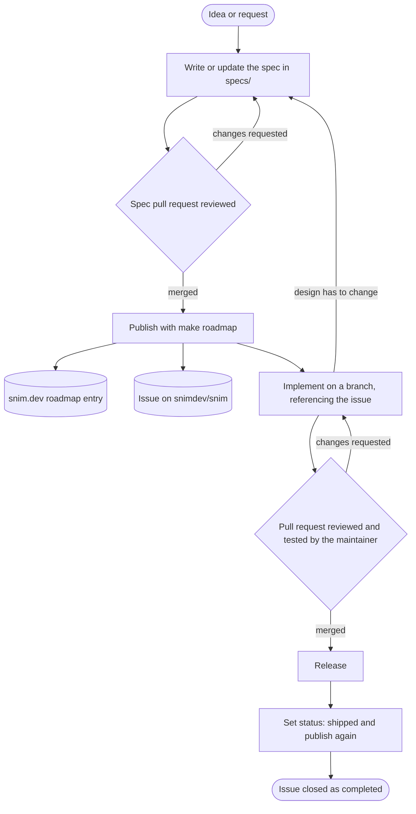

# Snim devenv

The development environment for [Snim](https://snim.dev), the screenshot, recording and OCR tool. It clones every Snim repository into one folder and holds the rules they are developed by.

```bash
git clone git@github.com:snimdev/devenv.git snim
cd snim
make clone     # clones the repos next to this README (private ones are skipped without access)
make status    # git status -sb across them
make pull      # git pull --rebase across them
```

| Folder | Repository | What it is |
| --- | --- | --- |
| `specs/` | [snimdev/specs](https://github.com/snimdev/specs) | Feature specs: where all development starts |
| `snim/` | [snimdev/snim](https://github.com/snimdev/snim) | The desktop app (C++20, Qt 6) |
| `homebrew-tap/` | [snimdev/homebrew-tap](https://github.com/snimdev/homebrew-tap) | The macOS Homebrew cask |
| `setup-msvc/` | [snimdev/setup-msvc](https://github.com/snimdev/setup-msvc) | GitHub Action for the Windows builds |

Any private repositories are cloned too when you have access.

## Spec-driven development

Every feature starts as a spec in `specs/`. Publishing it (`make roadmap`) creates its entry on the [snim.dev roadmap](https://snim.dev/roadmap) and its issue on the app repository, both generated from the same file. The code follows the spec, the spec is updated before the code when the design changes, and shipping it closes the issue. See [`AGENTS.md`](AGENTS.md) for the rules and [`specs/README.md`](https://github.com/snimdev/specs#readme) for the format.


